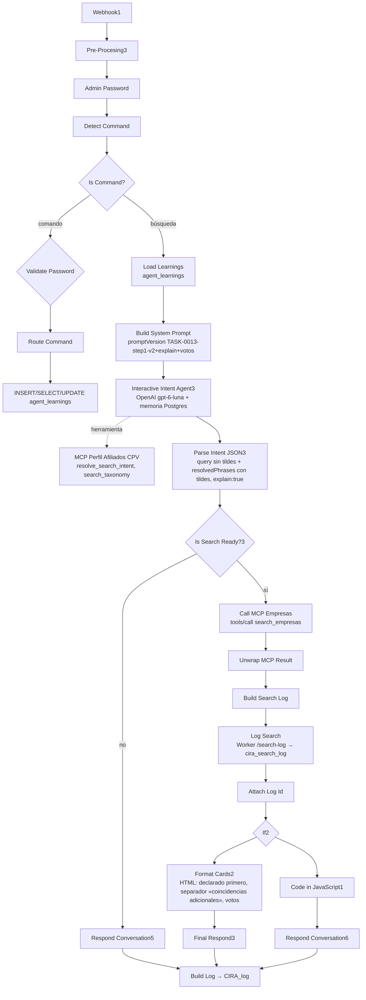

# TASK-0028 — CIRA: auditoría de fuentes, ranking y separación de capacidades y experiencias

| Campo | Valor |
|---|---|
| Fuente | Issue #2 `6913187637` (asignación del propietario, 2026-11-16) |
| Tipo | Auditoría de solo lectura, experimentos aislados y propuesta. **No implementa ni despliega nada** |
| Fecha de la evidencia | 2026-11-16, 09:57–10:40 UTC |
| Motor auditado | Flujo n8n `zbVLoCdR09IA9yQK` («Chat CIRA V5 - MCP», `versionId bafd597a…`, actualizado 2026-11-09 16:11:20Z) → Worker `perfilafiliados-mcp`, código `77ce273` (rama `feat/declared-first`, promovida como versión `1005d61f` el 2026-11-09) |
| Copia aislada | `pg_dump -Fc -n public` de la BD compartida a las 10:09:21Z (sha256 `5f6d39e3…`), restaurada en el contenedor `cpvt28-db` (ICU `en-US`, sin puertos publicados) |
| Artefactos | [`docs/cira/task0028/`](../docs/cira/task0028/): flujo n8n sanitizado, arnés y datos de los experimentos, mockup |

**Resumen ejecutivo.**
- **Causa de DISTEINSA, CONSORCIO OGS y TOTAL CLEAN:** el 100 % de su puntaje para «balancin» viene de experiencias, por dos vías. Una es la lista literal de experiencias. La otra es el `fulltext`, cuyo documento es en un 64 % texto de experiencias.
- **Lukiven:** coincide además por su categoría CPV declarada.
- **Etiquetas del cliente:** las dos consultas de balancines del lote 001 dan relevante solo a Lukiven y no relevantes a las otras tres.
- **Doble cómputo:** existe, porque `balancin` y `balancín` se buscan como dos frases. Es uniforme y no cambió el top 5 de ninguna consulta medida.
- **Alternativa A** (sin experiencias):
  - reduce el ruido conocido en el top 5 de 38 a 27;
  - mantiene la precisión sobre lo juzgado (47 %);
  - pierde 12 resultados relevantes del cliente en el top 10;
  - deja 6 consultas sin resultados.
- **Alternativa B** (dos grupos):
  - conserva la precisión y el menor ruido de A en el grupo principal;
  - recupera 11 de esas 12 relevantes en el grupo de experiencias, y la restante sigue en el grupo principal más abajo.
- **Rol (fabricante, vendedor, mantenedor):** **no se puede acreditar con los datos actuales**:
  - no hay un campo de rol;
  - el 79 % de los vínculos empresa–categoría son sugerencias automáticas (`suggested`);
  - la intención detectada no entra en el ranking.
- **Recomendación:** A como control y B como destino, por fases, **sin afirmar roles** hasta tener un dato de rol confirmado (§9).

---

## 1. Captura del motor real (Fase 1)

### 1.1 Qué flujo atiende a CIRA Test

| Cliente | Flujo n8n | Estado | Motor |
|---|---|---|---|
| `public/cira-test/index.html` (staging `5e6e3fc`) | `zbVLoCdR09IA9yQK` «Chat CIRA V5 - MCP» | activo | Worker `search_empresas` (este informe) |
| `public/kiosko-large/bot.html` | `Z2OvMPk0zj2MSYwL` «Chat CIRA V5» | activo, modificado el **2026-11-15 14:42Z** | herramientas MySQL + Gemini; **fuera de esta auditoría** |
| — | `b7VGYJrLUnVQRkcl` «Chat CIRA V5 copy» | activo, sin cliente encontrado | herramientas MySQL |
| — | `56IRGRc05pHckLIhKmbi9`, `9JLuVdo3Gk7NTbie`, `XloIXE37ynV8PYQW` | inactivos | usan `capacityView` |

**Cómo se verificó:** la ruta del webhook de cada flujo se comparó con la URL del cliente. Las rutas no se publican aquí.

**`capacityView` y `ExperienceView`:**
- existen como vistas en `public`;
- **ningún flujo activo las usa** (n8n, 49 flujos, búsqueda en el JSON de cada uno);
- el Worker tampoco las consulta.

### 1.2 Diagrama del flujo vivo (`bafd597a`)



Copia sanitizada, sin credenciales, contraseña de comandos, hosts, rutas de webhook, ids internos ni correos:
[`docs/cira/task0028/n8n/zbVLoCdR09IA9yQK_bafd597a_sanitizado.json`](../docs/cira/task0028/n8n/zbVLoCdR09IA9yQK_bafd597a_sanitizado.json).

**Puntos clave del flujo:**
- **Sin ranking en n8n:** n8n no ordena ni filtra. Envía `{query, resolvedPhrases, queryIntent, explain:true}` al Worker y pinta el orden que recibe.
- **Prompt:** `Load Learnings` inyecta filas de `agent_learnings` en el prompt del agente, lo que hace variable la reescritura de la consulta.
- **Separación visual actual:** `Format Cards2` (TASK-0013, paso 4) ya separa lo «declarado» de lo «adicional» con una etiqueta y un separador, **pero en una sola lista**.

### 1.3 ¿Coincide `cira_search_log` con el flujo vivo?

**Solo en parte.** `engine_version` se arma como `'flow ' + workflow.id + ' ' + promptVersion`, un texto fijo:
- las **67 filas** (2026-11-06 → 2026-11-15) dicen lo mismo, `flow zbVLoCdR09IA9yQK TASK-0013-step1-v2+explain+votos`;
- en ese periodo cambiaron el flujo (`0f55cd97` → `bafd597a`) y el Worker (`4742a36f` → `1005d61f`).

**La fila 52** («balancin», 2026-11-09 16:15:05Z, ejecución n8n `20869`):
- es posterior a la última actualización del flujo (16:11:20Z), así que corrió con el flujo vivo actual;
- su resultado trae `match_level`, que solo existe desde `feat/declared-first`, y eso es coherente con el Worker `1005d61f`.

**Limitación:** no hay credencial de Cloudflare en el almacén local, así que no se pudo leer la versión desplegada del Worker por la API. Sí se verificó de forma indirecta: el arnés con el código de `77ce273` reproduce el orden de `/debug-search` en vivo en 52 de 55 consultas (§4.1).

### 1.4 Tiempos de la ejecución 20869

| Tramo | ms |
|---|---|
| Agente (OpenAI + herramienta MCP) | 8 928 |
| `Call MCP Empresas` (Worker) | 3 772 |
| `Log Search` | 904 |
| Total (`response_ms` del registro) | 13 130 |

## 2. Cómo puntúa el Worker (código `77ce273`)

**Proceso de cálculo:**
- **Frases:** `search_empresas` arma `phrases = new Set([query, ...resolvedPhrases])`.
- **Listas por frase:** `computePhraseEvidence` calcula 11 listas por cada frase.
- **Puntaje:** cada empresa suma `peso / (60 + posición)` en cada lista donde aparece (RRF ponderado).
- **Fusión de frases:** las frases se suman con `mergePhraseEvidence`.
- **Orden final:** primero el nivel `declarado`, después el resto, cada bloque por puntaje.

### 2.1 Matriz fuente → consulta → ranking

| Lista | Fuente (tabla) | Consulta | Peso | Nivel | ¿Experiencias? |
|---|---|---|---|---|---|
| `structured` | `empresa_sector_service`+`services`+`sectors`, nombre (≥7 letras), certificaciones, sostenibilidad | `unaccent ilike` | 2,5 | declarado | no |
| `sector_focus` | ídem, empresas especializadas | sector principal/secundario o ≥50 % de servicios | 2,0 | declarado | no |
| `lexical_taxonomy` | `empresa_taxonomy_category` + nombres ES/EN + sinónimos | `unaccent ilike`; excluye familias genéricas | 2,5 | declarado | no |
| `canonical_cpv` | diccionario `taxonomy_terms` → CPV aprobado → `empresa_taxonomy_category` | resolutor canónico L0–L3 | 2,0 | declarado | no |
| `canonical_related` | familia CPV inmediata (L5) | solo si no hubo directa | 0,4 | similar | no |
| `name_typo` | `empresas.name` | `word_similarity`, solo si nada más coincidió | 2,0 | similar | no |
| `service` | `service_embeddings` | bge-m3, distancia < 0,60, máx. 8 | 1,0 | similar | no |
| `taxonomy` | `taxonomy_category_embeddings` | distancia < 0,47, máx. 10 | 0,5 | similar | no |
| `lexical_experiencia` | `empresa_experiencias.descripcion` | `unaccent ilike '%frase%'`, **`limit 20` sin `ORDER BY`** | 2,5 | adicional | **sí** |
| `experiencia` | `empresa_experiencia_embeddings` | distancia < 0,50, máx. 30 | 1,0 | adicional | **sí** |
| `fulltext` | `empresa_search_documents` | `websearch_to_tsquery('spanish')`, máx. 30 | 1,5 | adicional | **sí, mezclado** |

**Compuertas:**
- **Solo texto:** quita las coincidencias únicamente textuales cuando hay 3 o más empresas de catálogo.
- **«Similar» único:** quita las empresas que solo tienen una lista «similar a» cuando hay respaldo más fuerte.

**El documento de `fulltext`** (`BuildEmpresaSearchDocuments`):
- **Contenido:** nombre, sectores, servicios, categorías CPV (ES/EN, sinónimos y términos del diccionario), certificaciones, sostenibilidad **y todas las experiencias**, en un único `tsvector` sin pesos.
- **Peso de las experiencias:** en la copia, **las 961 experiencias aparecen literalmente** en los documentos y son el **64 %** del texto indexado (349 567 → 126 929 caracteres sin ellas).
- **Antigüedad:** los 406 documentos son del **2026-09-18 19:41:03** y nunca se regeneraron. No contienen los cambios posteriores, como la categoría «Balancín» de Lukiven del 2026-11-09.

**Rol:** `detected_intent` (`manufacturing`, `maintenance`, `supply`…) solo se informa en `/debug-search`; **no interviene en el ranking**.

## 3. Reproducción de «balancin» y aportes (Fase 2)

**Parámetros reales del agente:** `{"query":"balancin","resolvedPhrases":["balancín"],"queryIntent":"SERVICE","explain":true}` → frases `balancin` y `balancín`.

### 3.1 Aporte por lista (suma de las dos frases)

Aportes de la ejecución viva 20869; el arnés da los mismos valores.

| Empresa | Nivel | `lexical_taxonomy` | `canonical_cpv` | `taxonomy` (vect.) | `lexical_experiencia` | `fulltext` | `experiencia` (vect.) | Total | **De experiencias** |
|---|---|---|---|---|---|---|---|---|---|
| 157 LUKIVEN | declarado | 0,0820 | 0,0656 | 0,0164 | 0,0806 | 0,0492* | 0,0328 | 0,3266 | **50 %** |
| 91 DISTEINSA | adicional | — | — | — | 0,0820 | 0,0476* | — | 0,1296 | **100 %** |
| 333 CONSORCIO OGS | adicional | — | — | — | 0,0794 | 0,0484* | — | 0,1278 | **100 %** |
| 391 TOTAL CLEAN | adicional | — | — | — | 0,0781 | 0,0469* | — | 0,1250 | **100 %** |

\* Ese `fulltext` viene solo del texto de experiencias: en el documento sin experiencias (`esd_noexp`), «balancin» no encuentra a ninguna empresa.

**Datos de las cuatro empresas** (copia del 2026-11-16, solo lectura):

| Empresa | Lo declarado que toca «balancín» | Experiencias con «balanc» | Etiqueta del cliente (G2-07) |
|---|---|---|---|
| 157 LUKIVEN | categoría `CPV-29.04.02G` «Balancín» (bien), `self_declared`, creada el 2026-11-09 13:07 | 6, entre ellas «Fabricación de balancines (unidad de bombeo)…» (3 de fabricación, 2 de mantenimiento, 2 de suministro) | **relevante** |
| 91 DISTEINSA | ninguno; declara el servicio «EMPACADURAS Y SELLOS» | 1: sellado de fluidos Chesterton en balancines | no relevante |
| 333 CONSORCIO OGS | ninguno; único servicio «X», sin categorías | 3: mantenimiento de balancines dentro de contratos | no relevante |
| 391 TOTAL CLEAN | ninguno; 11 servicios, entre ellos «LIMPIEZA» | 1: «Mantenimiento (Mecánico, Balancines…)» dentro de un contrato de excelencia operacional | no relevante |

### 3.2 Duplicados en `result_evidence.fuentes`

**Es doble cómputo real, no solo de presentación.** Cada fuente aparece dos veces, una con `frase:"balancin"` y otra con `frase:"balancín"`, y las dos copias suman: los `aporte_pct` de Lukiven dan 99,8 % contando ambas.

**Causa:** `new Set([query, ...resolvedPhrases])` solo deduplica cadenas idénticas. `Parse Intent JSON3` manda la `query` sin tildes y agrega la versión con tildes a `resolvedPhrases`. Como todas las consultas usan `unaccent`, las dos frases devuelven las mismas listas.

**Efecto medido:**
- 16 de las 55 consultas tienen frases repetidas que solo difieren en tildes o mayúsculas;
- al deduplicarlas (variante `dedup` del arnés), **el top 5 no cambia en ninguna**, porque el factor ×2 es uniforme;
- el efecto visible es que la explicación muestra cada fuente dos veces y que el puntaje absoluto se duplica.

**Riesgo:** en consultas de varios conceptos donde solo uno trae variante con tildes, ese concepto pesa doble.

### 3.3 Respuesta a «¿por qué DISTEINSA y TOTAL CLEAN?»

1. Su `descripcion` en `empresa_experiencias` contiene «Balancines», y `lexical_experiencia` (`unaccent ilike '%balancin%'`) las encuentra.
2. Su documento de `fulltext` contiene esas mismas experiencias, y el stemming español reduce «balancines» y «balancín» a la misma raíz.
3. La compuerta «solo texto» **no se activa**: solo una empresa (Lukiven) coincide en el catálogo, y hacen falta 3.
4. Nada de lo que declaran (servicios, sectores, categorías) menciona balancines. Por eso quedan en el nivel `adicional`, debajo de Lukiven, pero **en la misma lista**.

## 4. Experimentos aislados (Fase 3)

### 4.1 Método

- **Datos y código:**
  - **Copia aislada:** la BD restaurada en `cpvt28-db`, en la red `cpvt28`, sin puertos publicados.
  - **Código del Worker:** el de `77ce273`, empaquetado tal cual con esbuild, que corre `computePhraseEvidence` sobre la copia.
  - **Listas vectoriales:** sin el token de `/embed` no se pueden recalcular. Se inyecta el aporte vectorial por empresa que devuelve `/debug-search` del Worker vivo, de solo lectura: no escribe `cira_search_log` ni votos.
- **Consultas** (55):
  - 49 combinaciones reales de parámetros del agente, tomadas de `cira_search_log`; 31 de ellas tienen etiquetas del cliente (lote 001);
  - 6 consultas de intención de la asignación que no estaban registradas, con parámetros sintéticos según la regla de `Parse Intent JSON3` (sin agente).
  - Están en [`experimentos/cases.json`](../docs/cira/task0028/experimentos/cases.json).
- **Fidelidad:** el orden «Actual» del arnés coincide con el vivo en **52 de 55** consultas. Las 3 restantes tienen el mismo conjunto y el mismo top 5, y difieren en empates de posiciones bajas.
- **Variantes:**
  - **Actual:** el Worker tal cual.
  - **A:** sin `lexical_experiencia` ni `experiencia` (literal y vectorial), y con `fulltext` sobre `esd_noexp`. Las compuertas se recalculan.
  - **B:** grupo 1 = A; grupo 2 = empresas con evidencia de experiencia (literal, vectorial o `fulltext` solo por experiencias) que no están en el grupo 1, máximo 10.
  - **dedup:** Actual con las frases deduplicadas sin tildes.
- **Archivos:** el arnés, los scripts y los resultados (solo ids, sin nombres) están en [`docs/cira/task0028/experimentos/`](../docs/cira/task0028/experimentos/).

### 4.2 Métricas con etiquetas reales del cliente (31 consultas del lote 001)

No se inventaron etiquetas. Las empresas sin juicio del cliente cuentan como «sin juicio» y no como acierto.

| Métrica | Actual | A | B (grupo 1 visible primero; cobertura con ambos grupos) |
|---|---|---|---|
| Relevantes en el top 5 | 34 | 24 | 24 |
| **No relevantes** en el top 5 | **38** | **27** | **27** |
| Sin juicio en el top 5 | 50 | 53 | 53 |
| Precisión sobre lo juzgado (rel / (rel + no rel)) | 47,2 % | 47,1 % | 47,1 % |
| Precision@5 (cota inferior, rel / 5 por consulta, suma) | 34 / 155 | 24 / 155 | 24 / 155 |
| Relevantes en el top 10 (cobertura) | **39/49** | 30/49 | **39/49** (grupo 1 top 10 + grupo 2 top 10) |
| Consultas sin resultados (de 55) | 2 | **6** | 2 |
| Resultados totales (55 consultas) | 668 | 543 | 670 |

**En las 55 consultas:** 46 de las 217 posiciones del top 5 de Actual (21 %) son empresas cuyo puntaje es **100 % de experiencias**.

### 4.3 Omisiones de A (relevantes del cliente que salen del top 10)

| Consulta (cliente) | Empresas | ¿Las recupera B? |
|---|---|---|
| levantamiento artificial (G1-02) | 276 | sí, grupo 2 |
| revestidor (G1-03) | 157 (puesto 1 en Actual) | sí, grupo 2 (puesto 1) |
| mechurrio (G2-03) | 140 | sí, grupo 2 |
| macolla (G2-04) | 155, 171, 1, 76: **las 4 relevantes**; A no devuelve nada | sí, grupo 2 |
| guaya eléctrica (G2-06) | 79 | sí, grupo 2 |
| camión chupón (G2-09) | 391 | sí, grupo 2 |
| drilling (G6-04) | 96 | sigue en el grupo 1, del puesto 2 al 15 |

**Conclusión:** las experiencias **sí** aportan relevancia real en consultas de equipos o jerga («macolla», «mechurrio», «camión chupón»). Excluirlas por completo (A) es un buen control, pero un mal destino.

### 4.4 Consultas de intención (balancines y válvulas)

Las listas son ids. Las etiquetas del cliente solo existen para G2-07 y G5-02.

| Consulta | Intención detectada | Actual (top 5) | A / B grupo 1 | B grupo 2 | Observación |
|---|---|---|---|---|---|
| balancin (G2-07) | generic | 157, 91, 333, 391 | **157** | 91, 333, 391 | B coincide exactamente con el juicio del cliente |
| fabricantes de balancines | manufacturing | 157 | 157 | — | Lukiven entra por `canonical_cpv`. Su rol de fabricante solo consta en experiencias |
| fabriquen y mantengan balancines (G5-02) | generic | 157, 333, 107, 391, 138 | 157, 107, 138, 74, 94 | 333, 391, 487, 83 | No relevantes en el top 5: 3 → 1. Las nuevas (74, 94) llegan por «servicio parecido» |
| venta de balancines | supply | 157, 333 | 157 | 333 | Ninguna declara venta |
| mantenimiento de balancines | maintenance | 157, 333, 391, 74, 487 | 157, 74, 107, 73, 94 | 333, 391, 487 | OGS y Total Clean pasan al grupo 2; el grupo 1 se llena con servicios parecidos |
| sellado de fluidos en balancines | generic | 91, 487 | 487, 91 | — | DISTEINSA declara «EMPACADURAS Y SELLOS»: pertinente para esta intención |
| limpieza de balancines | generic | 391, 523, 333 | 391, 523 | 333 | Total Clean y VENELIN declaran «LIMPIEZA» |
| fabricación de válvulas industriales | manufacturing | 560, 487, 480, 75, 563 | 560, 100, 187, 138, 141 | 487, 480, 333, 75, 391 | El grupo 1 de A trae ruido semántico («similar a»: 100 químicos, 187 geociencias) |
| mantenimiento de válvulas industriales | maintenance | 560, 107, 333, 480, 391 | 122, 107, 194, 75, 78 | 560, 333, 480, 391, 487 | 560 («Ingeniería de Válvulas…») pasa al grupo 2: su mantenimiento de válvulas solo consta en experiencias |
| válvulas de bola | generic | 80, 560, 487, 573, 107 | **573** | 80, 560, 487, 107, 157 | 573 es una **empresa de QA activa** (§7) |

**Exactitud de rol:** no se puede medir con etiquetas, porque no existen etiquetas de rol, y el dato tampoco lo permite:
- no hay un campo de rol (fabricante, distribuidor o servicio);
- `tipo_oferta` (bien o servicio) solo existe en las categorías hoja;
- de los 937 vínculos empresa–categoría, **742 (79 %) son `suggested`** (127 empresas), 188 `self_declared` (7 empresas) y 7 `validated` (5 empresas).

En el caso medido, el único rol con evidencia, la fabricación de balancines de Lukiven, **está en experiencias**. Una regla que «solo acredita rol con lo declarado» no podría afirmarlo.

### 4.5 Latencia

| Medición | Valor |
|---|---|
| `/debug-search` vivo, 55 consultas | mediana 1 227 ms, p90 1 553 ms |
| Arnés en la copia (red local, sin embeddings): Actual / A / B | mediana 23 / 24 / 35 ms |

**Interpretación:**
- **A:** no agrega consultas, así que no agrega latencia.
- **B:** agrega 2 consultas por frase (literal de experiencias y `fulltext` sin experiencias, para clasificar el origen), unos +50 % de tiempo de BD en la copia.
- **En vivo:** el costo dominante es la latencia de red del Worker hacia Supabase. **Implementado en el Worker, B se puede hacer sin consultas extra**, si las listas se etiquetan por origen en lugar de repetirse.

## 5. Propuesta UX para CIRA Test (Fase 4)

**Mockup estático, sin desplegar:** [`docs/cira/task0028/mockup/cira_test_dos_grupos.html`](../docs/cira/task0028/mockup/cira_test_dos_grupos.html). Usa el resultado real de B para «balancín».

1. **Sección principal**, «Empresas que ofrecen productos o servicios relacionados». Cada tarjeta muestra:
   - la **categoría o el servicio concreto** que coincidió;
   - si el vínculo lo **declaró la empresa** o lo **sugirió el sistema** (`self_declared`/`validated` frente a `suggested`);
   - el **rol solo si hay un dato declarado que lo sustente**; si no, «Rol no acreditado en el perfil»;
   - la explicación y el enlace al perfil.
   - Si la empresa también tiene experiencias relacionadas, se muestran como **complementarias**, plegadas, con la aclaración de que no acreditan fabricación o comercialización.
2. **Sección secundaria**, «Empresas con experiencias relacionadas», separada y **plegada por defecto**. Cada tarjeta muestra un fragmento del proyecto o actividad, lo que la empresa sí declara y la nota «La experiencia no acredita fabricación o comercialización». Sin duplicados entre las dos secciones.
3. **Selector** «Solo capacidades» (por defecto) / «Capacidades + experiencias».
   - **Excepción:** si la sección principal queda vacía, como en «macolla», la secundaria se abre sola con un aviso. Así no se repite la pérdida de cobertura de A.
   - **Sin JavaScript:** en el HTML que arma `Format Cards2`, el selector puede ser un `<details>`, que no requiere JavaScript en el cliente.

### 5.1 Contrato de datos propuesto (aditivo, sin migración)

**Respuesta de `search_empresas`:** los campos actuales se conservan y se agregan estos:

```jsonc
{
  "id": "157",
  "match_level": "declarado",               // ya existe
  "grupo": "capacidad",                      // nuevo: "capacidad" | "experiencia"
  "capacidad": {                             // nuevo, solo en el grupo "capacidad"
    "tipo": "categoria_cpv",                 // "categoria_cpv" | "servicio" | "sector"
    "codigo": "CPV-29.04.02G", "nombre": "Balancín", "tipo_oferta": "bien",
    "origen": "self_declared",               // self_declared | validated | suggested
    "rol": null                              // solo con un dato declarado que lo sustente
  },
  "experiencias_relacionadas": [{ "fragmento": "Fabricación de balancines…", "experiencia_id": 610 }],
  "explain": { "fuentes": [ /* una entrada por lista, sin repetir variantes con tildes */ ] }
}
```

**Compatibilidad:**
- **Votos 👍/👎 y `cira_search_feedback`:** no cambian. El voto sigue siendo por `search_log_id` + `empresa_id`.
- **`cira_search_log`:** `result_evidence` es `jsonb`, así que admite el campo `grupo` por resultado **sin migración**. `result_empresa_ids` mantiene el orden mostrado: grupo 1 y después grupo 2.
- **Campaña de evaluación (TASK-0027) y sus instantáneas inmutables:** las instantáneas guardan lo que se mostró. Las evaluaciones anteriores al cambio siguen siendo válidas como de «una sola lista». Conviene registrar la versión real del motor (§6.4) para separar las campañas.
- **Migración:** no hace falta. Para que `fulltext` no indexe experiencias basta con **regenerar** `empresa_search_documents` con otra composición (§6). Eso escribe en la BD compartida y requiere su propio gate.

## 6. Plan de implementación por fases (propuesta, no autorizada)

| Fase | Cambio | Dónde | Gate |
|---|---|---|---|
| 0 | Deduplicar frases sin tildes ni mayúsculas, sin cambiar el orden medido; quitar fuentes repetidas de la explicación | Worker `empresa-tools.ts` (construcción de `phrases`) y `search-explain.ts` | Versión del Worker + regresión congelada |
| 0 | `ORDER BY` determinista en `lexical_experiencia` (hoy `limit 20` sin orden) | Worker `hybrid-search.ts` | ídem |
| 1 | Etiquetar cada resultado con `grupo` y `capacidad` (origen y tipo_oferta), sin cambiar el orden | Worker `hybrid-search.ts`, `empresa-tools.ts` | ídem |
| 2 | Dos secciones y selector en las tarjetas; `grupo` en `result_evidence` | n8n `Format Cards2`, `Build Search Log` | Autorización de edición n8n, respaldo previo |
| 3 | `fulltext` sin experiencias: regenerar `empresa_search_documents` sin ellas y dejar las experiencias solo en sus dos listas | Laravel `BuildEmpresaSearchDocuments` + ejecución sobre la BD compartida | Escritura en la BD compartida (conteos antes/después) |
| 4 | Ordenar el grupo 1 con la evidencia de catálogo (A) y el grupo 2 con la de experiencias | Worker | Regresión + métricas de §4.2 |
| 5 | Rol: dato de rol confirmado (campo declarado o categorías `validated`) antes de mostrar «fabricante» o «distribuidor» | Datos y perfil (Laravel) | Decisión del propietario y de la Cámara |

**Rollback:**
- **Worker:** volver a la versión previa con `wrangler versions deploy 1005d61f…@100%`. Es la reversión ya usada en TASK-0013.
- **n8n:** reimportar el respaldo previo del flujo, fuera del repo.
- **`empresa_search_documents`:** regenerarlo con la composición anterior, que es determinista a partir de las tablas fuente.
- **Base de datos:** ningún paso exige migración.

### 6.4 Trazabilidad que falta

`engine_version` debería registrar el `versionId` del flujo y la versión del Worker. Hoy es un texto fijo (§1.3).

## 7. Otros hallazgos (sin cambios hechos)

- **Empresas de QA activas en la BD compartida:**
  - **Cuáles:** cuatro empresas «EMPRESA QA FASE E EDITADA…» (573–576, `status_id = 1`), creadas el 2026-09-01.
  - **Efecto:** la 573 tiene 8 categorías de válvulas `self_declared` y aparece en búsquedas reales: en `cira_search_log` 1 vez, y en «válvulas de bola» es el único resultado del grupo 1 de A.
  - **Siguiente paso:** decisión del propietario.
- **Familias genéricas:** el Worker excluye `CPV-29.02`, `CPV-12.04`, `CPV-48.02` y `CPV-22.08`; Laravel solo las tres primeras. Es un desfase de listas fijas entre repositorios.
- **Flujos activos con MySQL:** «Chat CIRA V5» (kiosco) se modificó el 2026-11-15 y sigue con herramientas MySQL. Su comportamiento no es el de CIRA Test.

## 8. Riesgos y regresiones

| Riesgo | Efecto | Mitigación |
|---|---|---|
| Perder cobertura en jerga y equipos (macolla, mechurrio) | Sección principal vacía | La secundaria se abre sola si la principal está vacía; medir con §4.3 |
| Grupo 1 con «servicio parecido» como capacidad | Ruido (válvulas, mantenimiento de balancines) | Mostrar «parecido (sugerencia)» aparte dentro del grupo 1, o exigir respaldo léxico o declarado |
| Afirmar un rol sin dato | Información falsa al usuario | `rol: null` hasta la fase 5 |
| Vínculos `suggested` presentados como declarados | Falsa capacidad | Mostrar el origen; evaluar no contar `suggested` como «declarado» |
| Evaluaciones de la Cámara de una lista contra dos | Comparación inválida | Registrar la versión real del motor; separar campañas |
| Documento `fulltext` desactualizado (2026-09-18) | Diferencias entre lo declarado y lo indexado | Regenerarlo en la fase 3 y programar su actualización |

## 9. Decisión recomendada

1. **A como experimento de control:** ya ejecutado. Confirma que el ruido «balancín» viene de experiencias, pero excluirlas por completo pierde 12 relevantes del cliente y vacía 6 consultas. **No se recomienda A como destino.**
2. **B como destino, por fases (§6), con condiciones:**
   - **Se cumple:**
     - reduce los no relevantes visibles primero (38 → 27 en el top 5 de las consultas etiquetadas);
     - conserva la cobertura (39/49 con ambos grupos);
     - no rompe votos ni evaluaciones, porque los campos son aditivos;
     - el rollback es verificable (Worker y n8n con respaldo).
   - **No se cumple todavía:** «clasificar roles con evidencia». El dato no existe. Por eso B se implementa **sin afirmar roles** («rol no acreditado»), y el rol queda para la fase 5.
3. **Antes de B:** la fase 0 (deduplicar frases y ordenar la lista literal de experiencias) es de bajo riesgo y no cambia el orden medido.

## 10. Respuestas a las preguntas de la asignación

1. **Causa exacta de DISTEINSA y TOTAL CLEAN:** §3.3. Solo `lexical_experiencia` y un `fulltext` cuyo documento incluye experiencias; nada declarado coincide; la compuerta de texto no se activa con una sola empresa de catálogo.
2. **Aporte de la experiencia por resultado:** §3.1. Lukiven 50 %; DISTEINSA, OGS y Total Clean 100 %. En las 55 consultas, el 21 % de las posiciones del top 5 son 100 % experiencia.
3. **¿Se puede excluir por completo sin romper las fuentes principales?** Técnicamente sí: hay que quitar 2 listas y regenerar `fulltext` sin experiencias; las fuentes de catálogo no cambian. Pero cuesta cobertura (§4.3). Quitar solo las listas **no basta**: el 64 % del documento `fulltext` son experiencias.
4. **Intenciones de fabricación, venta, mantenimiento, limpieza y sellado:** el Worker detecta `manufacturing`, `maintenance` y `supply`, pero no las usa para ordenar. Los datos declarados no tienen rol. Solo «sellado» (DISTEINSA, «EMPACADURAS Y SELLOS») y «limpieza» (Total Clean y VENELIN, «LIMPIEZA») tienen un servicio declarado acorde. La fabricación, el mantenimiento y la venta de balancines solo constan en experiencias (§4.4).
5. **Omisiones de A:** §4.3. Son 12 relevantes del cliente en 7 consultas, y 6 consultas sin resultados.
6. **Cobertura útil de B:** 39/49 relevantes; 11 de las 12 omisiones de A en el grupo 2, y la restante en el grupo 1. En «balancín», B coincide con el juicio del cliente.
7. **Aspecto visual en CIRA Test:** §5 y el mockup.
8. **Nodos y archivos a cambiar:**
   - Worker: `empresa-tools.ts`, `hybrid-search.ts`, `search-explain.ts`;
   - n8n: `Format Cards2` y `Build Search Log`;
   - Laravel: `BuildEmpresaSearchDocuments`;
   - `public/cira-test/index.html` no necesita cambios si el selector es `<details>`.
9. **Regresiones y rollback:** §6 y §8.
10. **Decisión sustentada:** §9.

## 11. Evidencia de cero mutaciones y limitaciones

**Sin mutaciones en los sistemas vivos:**
- **n8n:** solo `GET` de flujos y de la ejecución 20869. El `versionId` y el `updatedAt` del flujo vivo son los mismos al empezar y al terminar (§12 de la tarea).
- **BD compartida:**
  - solo `SELECT` en transacciones `READ ONLY` revertidas y un `pg_dump` (lectura);
  - `cira_search_log` tenía 67 filas antes y después;
  - `esd_noexp` y las pruebas se escribieron **solo en la copia aislada**.
- **Worker:** solo `/debug-search`, de lectura y sin registro. Sin despliegues: no hay credencial de Cloudflare.
- **Staging:** sigue en `5e6e3fc`, sin cambios.

**Limitaciones:**
- **Listas vectoriales:** se inyectan desde el vivo, sumadas por empresa, en vez de recalcularse en la copia. La compuerta «similar» de A se reaplica por empresa y no por frase.
- **Consultas sintéticas:** las 6 no pasan por el agente.
- **Etiquetas de rol:** no existen.
- **Versión del Worker:** la desplegada no se leyó por la API (§1.3).
