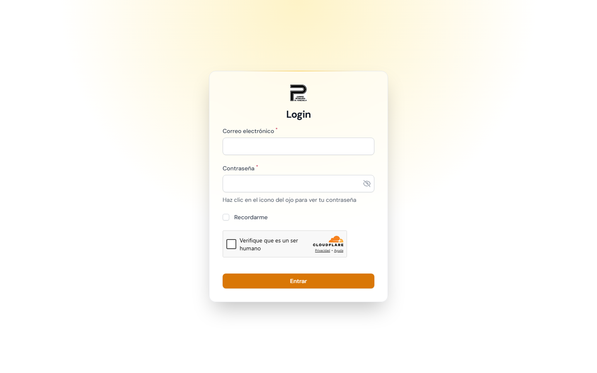
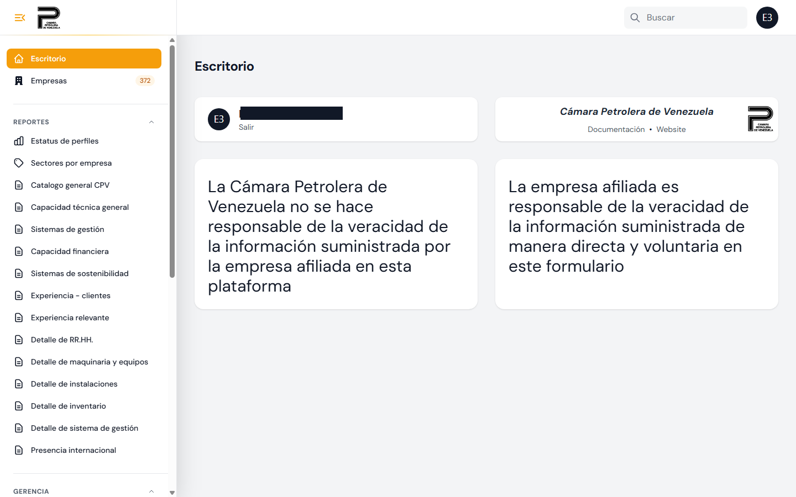
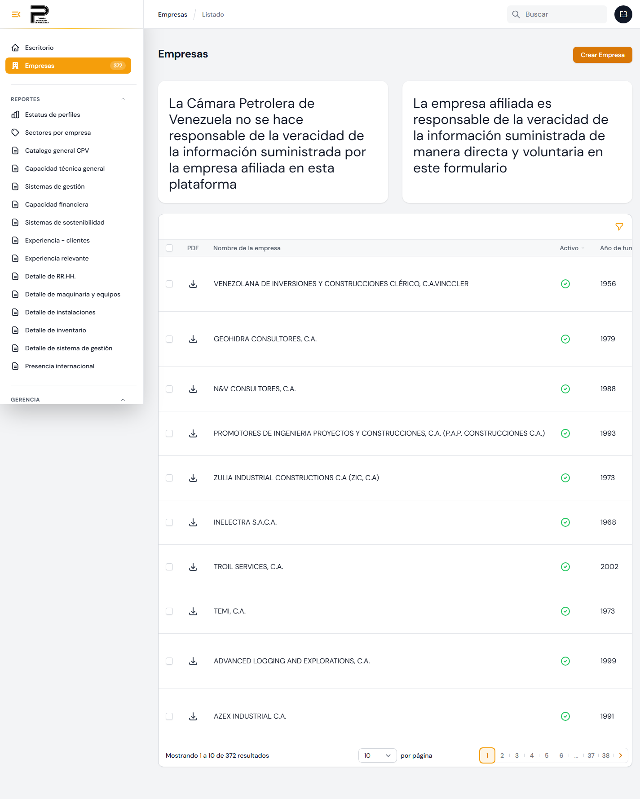
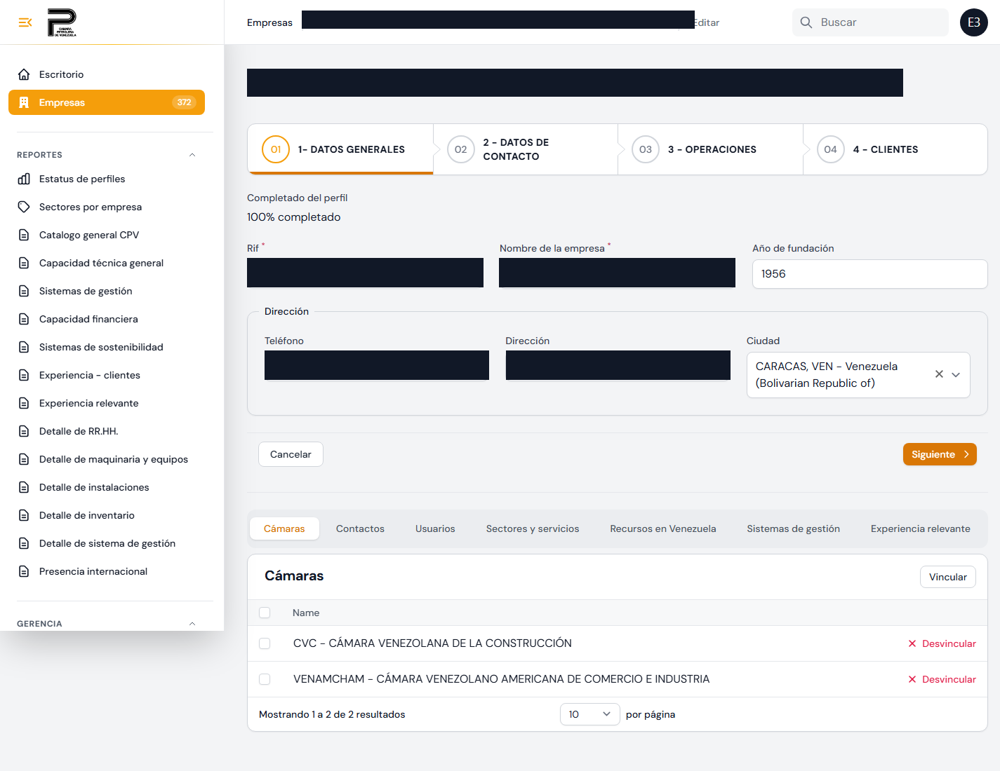
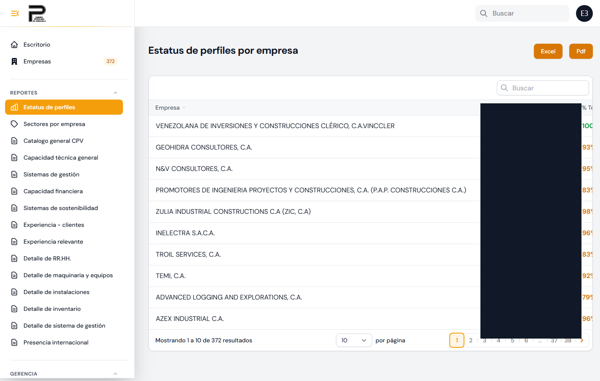
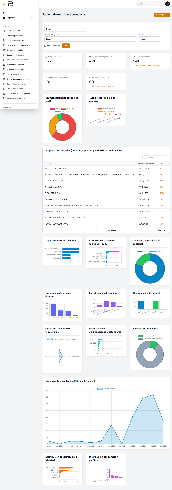
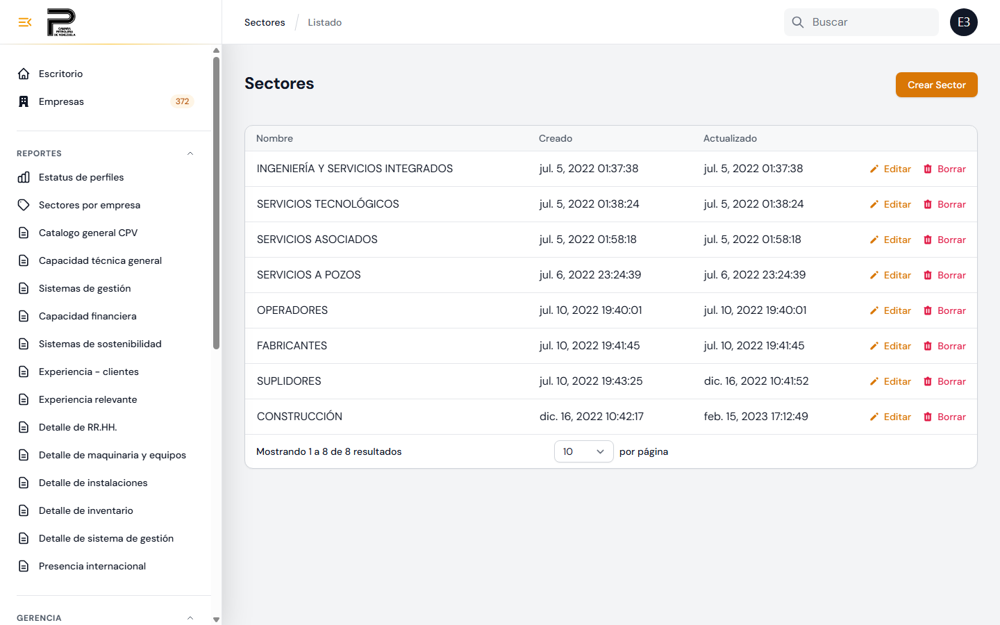
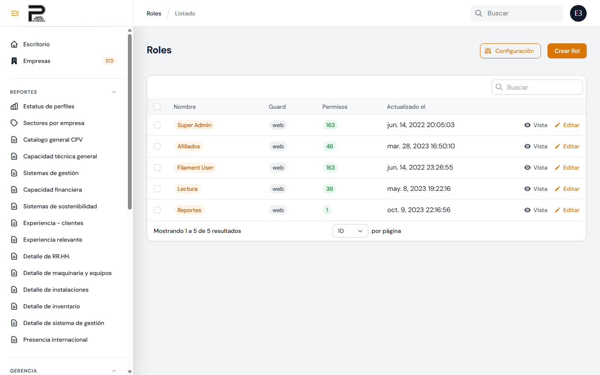

# Perfil de Afiliados — Manual del Administrador

**Guía de administración para el personal de la Cámara**
Cámara Petrolera de Venezuela
Versión 1 — 17 de agosto de 2026

**Sitio:** https://camarapetrolera.app

> Este manual describe las funciones de **administración** (rol Cámara). El manual del afiliado
> —lo que carga cada empresa— está en `docs/manual_usuario/manual_usuario.md`. Aquí se documenta
> cada acción y opción que el administrador puede gestionar, incluidas las que **no** son visibles
> para los afiliados.
>
> **Capturas:** este manual incluye capturas reales del panel de administración. Para **actualizarlas**
> más adelante, use el script `capturar_admin.mjs` (ver **Anexo A**). Recuerde que muestran datos
> reales de las empresas: **tape lo sensible antes de distribuir** el documento.
>
> **Nota de privacidad (24-ago-2026):** se revisaron las 7 capturas de `capturas_admin/` antes de
> commitear este manual. Se taparon con recuadros negros: el RIF/teléfono/dirección/nombre de la
> empresa de ejemplo (sección 3.2), los nombres reales de "Usuario principal" de las 9 empresas
> visibles en el reporte de Estatus de perfiles (sección 5), y el nombre del administrador que
> tenía la sesión iniciada (sección 2, Escritorio). El resto de las capturas solo muestra nombres
> de empresas o datos agregados — se consideró de menor sensibilidad para un manual de uso interno
> de la Cámara, a diferencia del manual del afiliado que se distribuye a los 372 afiliados. Si se
> regeneran las capturas con `capturar_admin.mjs`, hay que repetir esta revisión antes de
> redistribuir el manual.

---

## Índice

1. Roles y qué ve cada uno
2. Ingreso al panel
3. Gestión de Empresas (crear, editar, activar, eliminar)
4. Asignar afiliados y datos que precarga la Cámara (RIF, Nombre, Sector Principal)
5. Estatus de perfiles — el reporte de completitud
6. Tablero de métricas gerenciales
7. Reportes por módulo
8. Catálogos maestros (Mantenimiento)
9. Roles y permisos
10. Preguntas frecuentes del administrador (incluye RIF y % de completitud)
11. Solicitudes de categoría: «Analizar con IA»

---

## 1. Roles y qué ve cada uno

El sistema tiene tres tipos de acceso (gestionados con Filament Shield):

| Rol | Quién es | Qué puede hacer |
|---|---|---|
| **super_admin** | Personal de la Cámara (administrador) | Todo: crear/editar/activar/desactivar/eliminar empresas, definir el Sector Principal, ver todos los reportes y el tablero gerencial, administrar catálogos y roles. |
| **affiliates** | La empresa afiliada | Solo carga y consulta **su propia** empresa; ve **su propio** porcentaje de perfil. No ve reportes agregados ni el tablero gerencial. |
| **filament_user** | Acceso básico al panel | Acceso mínimo; se usa como base antes de asignar un rol definitivo. |

> **Clave:** las funciones de reportes agregados y gerencia están protegidas por permiso. Un afiliado
> **no** las ve aunque conozca la URL.

---

## 2. Ingreso al panel

**Ingreso:** https://camarapetrolera.app/admin/login

1. Escriba su correo y contraseña de administrador. El correo es el usuario. Si olvidó la contraseña, use
   **¿Olvidaste tu contraseña?** (ver la sección 10, «Un afiliado olvidó su contraseña…»).
2. El menú lateral muestra los grupos según sus permisos: **Empresas**, **Reportes**, **Gerencia**,
   **Mantenimiento** y **Roles**.

Una vez dentro verá el **Escritorio**, con el menú por grupos a la izquierda:

---

## 3. Gestión de Empresas

Es el módulo central. Menú **Empresas**.

### 3.1 Listado de Empresas

Columnas: descarga **PDF** del perfil, Nombre, **Activo** (indicador), Año de fundación, Ciudad,
País, Sector principal, Servicios y **% Perfil** (porcentaje de completitud de esa empresa).

**Filtros disponibles:** Activo (sí/no), País, Ciudad y Sector.

> El listado muestra las empresas **asociadas a su usuario**. Si necesita ver el estado de *todas*
> las empresas, use el reporte **Estatus de perfiles** (sección 5) o el **Tablero gerencial**
> (sección 6). Si una empresa no aparece en su listado, verifique que su usuario esté vinculado a
> ella (pestaña Usuarios, sección 4.3).

### 3.2 Crear o editar una empresa

Al crear/editar se completan estos campos:

- **RIF** (obligatorio y único).
- **Nombre de la Empresa** (obligatorio).
- **Año de Fundación**, **Teléfono**, **Ciudad**.
- **Sitio web** y redes sociales (LinkedIn, Twitter/X, Instagram, Facebook, YouTube, Otros).
- **Sector Principal** (obligatorio) y **Sector Secundario** (opcional, debe ser distinto del
  principal). *Ver 4.2.*
- **Facturación anual:** `< 100.000 USD` · `100.001 – 1.000.000` · `1.000.001 – 10.000.000` ·
  `> 10.000.001`.
- **Empleados:** `< 50` · `51 – 100` · `101 – 500` · `> 500`.
- **Estatus actual:** Activa / Inactiva.
- **Propiedad:** Privado / Público.
- **Origen del capital:** Nacional / Internacional.
- **Clientes** (nombre y país), se agregan tantas líneas como haga falta.

### 3.3 Acciones sobre empresas (selección múltiple)

En el listado, seleccione una o varias empresas para habilitar:

| Acción | Quién puede | Qué hace |
|---|---|---|
| **Editar** | Todos | Abre la empresa seleccionada (solo con 1 marcada). |
| **Activar** | Solo super_admin | Marca las empresas como Activas. |
| **Desactivar** | Solo super_admin | Marca las empresas como Inactivas. |
| **Eliminar** | Solo super_admin | Borra las empresas **y todos sus datos asociados**. Pide escribir `BORRAR` para confirmar. **No se puede deshacer.** |
| **Exportar** | Todos | Descarga el listado (Excel/PDF). |

> **Eliminar** borra Recursos, Sistemas de gestión, Experiencias, Presencia, Sostenibilidad y
> Contactos propios de esa empresa. Los catálogos compartidos (Cámaras, Sectores/Servicios,
> usuarios) solo se **desvinculan**, no se borran.

---

## 4. Datos que precarga la Cámara y asignación de afiliados

### 4.1 RIF y Nombre

Al **registrar** una empresa, la Cámara es quien captura el **RIF** y el **Nombre**. En la práctica
la Cámara suele precargar también el resto de los datos generales. El afiliado, al entrar, solo debe
**verificar** que el RIF esté correcto; si algo está mal, lo corrige la Cámara.

### 4.2 Sector Principal (exclusivo de la Cámara)

El **Sector Principal** solo lo puede editar el **super_admin**. Para el afiliado el campo aparece
**bloqueado**, con la nota: *"Este dato lo define la Cámara Petrolera al registrar tu empresa."* El
**Sector Secundario** sí lo puede editar el afiliado. Máximo 2 sectores por empresa.

### 4.3 Vincular usuarios (afiliados) a una empresa

Dentro de la empresa, pestaña **Usuarios**: use **Vincular** para asociar la cuenta del afiliado a
su empresa. Hasta que esté vinculado, el afiliado no verá ninguna empresa en su escritorio.

### 4.4 Otras pestañas de la empresa

Cámaras · Contactos · Servicios · Recursos (Assets) · Gestión · Experiencias · Presencia ·
Sostenibilidad. Son las mismas secciones que carga el afiliado; el administrador puede consultarlas
o completarlas.

---

## 5. Estatus de perfiles — el reporte de completitud

Menú **Reportes → Estatus de perfiles**. **Visible solo para la Cámara** (protegido por permiso).

Es una tabla con **todas** las empresas afiliadas y su avance de carga:

- **Empresa** y **Usuario principal**.
- **% Total** (promedio de los módulos), resaltado por color: verde 100 %, amarillo parcial, rojo 0 %.
- Una columna por módulo: **Datos Grales., Sectores, Contactos, Recursos, Gestión, Presencia,
  Experiencia, Sostenibilidad**.
- Un clic en una fila abre la empresa para editarla.
- Botones **Excel** y **PDF** para exportar el reporte.

### Cómo se calcula el porcentaje

- El perfil se divide en **8 módulos**; el **% Total** es el **promedio** de esos 8.
- Un módulo cuenta como **completo (100 %)** si tiene datos cargados **o** si se marcó **"No Aplica"**.
- **Datos Generales** siempre cuenta como 100 % (por eso el RIF/Nombre precargados no dejan el perfil
  incompleto).
- En **Recursos** y **Gestión**, que tienen varios subtipos, el porcentaje refleja cuántos subtipos
  están completos o marcados "No Aplica".

> **Este reporte es de la Cámara.** El afiliado **no** lo ve. El afiliado solo ve **su propio**
> porcentaje (columna "% Perfil" en su empresa e indicador por pestaña). Ver también la sección 10.

---

## 6. Tablero de métricas gerenciales

Menú **Gerencia → Tablero gerencial**. **Solo Cámara** (protegido por permiso).

Panel de indicadores para la Junta Directiva, con gráficos de: resumen general, calidad de perfiles,
uso de "No Aplica", empresas estancadas, top de sectores, cobertura de servicios, diversificación,
empleo, facturación, composición de capital, recursos, certificaciones, alcance internacional,
crecimiento de afiliación, distribución geográfica y por cámaras.

- **Filtros:** por Sector, Cámara y Estado.
- Botón **Descargar PDF** del tablero.

---

## 7. Reportes por módulo

Menú **Reportes**. Vistas consolidadas por sección (Clientes, Experiencia, Instalaciones, Finanzas,
Inventario, Maquinaria, Gestión, Presencia, Recursos, Sectores, Sostenibilidad, etc.), útiles para
revisar un aspecto en todas las empresas. Se rigen por los mismos permisos: **visibles para la Cámara**.

---

## 8. Catálogos maestros (Mantenimiento)

Menú **Mantenimiento**. Son las listas que alimentan los formularios del afiliado; manténgalas al
día para que los afiliados elijan opciones correctas.

- **Sectores** y **Servicios** (los servicios se agrupan por sector).
- **Cámaras** (capítulos/cámaras a las que puede pertenecer una empresa).
- **Ubicaciones** (países y ciudades).
- **Áreas**.
- **Infraestructura:** Sectores, Tipos, Sistemas, Región o Distrito e Instalaciones (usados en
  Experiencia Relevante).
- **Clientes** (catálogo de referencia).

Cada catálogo permite **crear, editar y eliminar** registros. Evite eliminar un elemento que ya esté
en uso por alguna empresa.

---

## 9. Roles y permisos

Menú **Roles** (Filament Shield). Permite:

- Crear roles y asignarles permisos por recurso y por página (por ejemplo, dar acceso a "Estatus de
  perfiles" o al "Tablero gerencial").
- El rol **super_admin** tiene todos los permisos.
- Asigne a cada usuario el rol que corresponda (`affiliates` para empresas, `super_admin` para la
  Cámara).

> Recomendación: otorgue **super_admin** solo al personal de confianza de la Cámara; los reportes
> agregados y la eliminación de empresas dependen de ese rol.

- **Solo un super_admin administra roles.** Al guardar un rol, el editor cambia únicamente las casillas que
  muestra; los permisos que no tienen casilla se conservan.
- La sección **Role** del editor muestra los permisos reales de administración de roles (`view_role`,
  `update_role`, etc.) en **solo lectura**: no se pueden dar a otro rol ni quitar a super_admin desde aquí.

---

## 10. Preguntas frecuentes del administrador

**¿El afiliado ve el "reporte de completitud"?**
No. El afiliado solo ve **su propio** porcentaje de perfil (el de su empresa). El **reporte con
todas las empresas** ("Estatus de perfiles", sección 5) y el **Tablero gerencial** (sección 6) son
exclusivos de la Cámara y están protegidos por permiso. Si desea que el afiliado **tampoco** vea su
propio porcentaje, eso requiere un ajuste en el sistema (ocultar ese indicador), no un cambio de
manual — coordínelo con el equipo de desarrollo.

**¿Quién carga el RIF y el Nombre de la empresa?**
Los precarga la **Cámara** al registrar la empresa. El campo RIF es obligatorio y único. El afiliado
solo debe **verificarlo**; si está mal, lo corrige la Cámara. El **Sector Principal** también lo
define la Cámara y aparece bloqueado para el afiliado.

**Un afiliado no ve su empresa. ¿Por qué?**
Su usuario no está vinculado a la empresa. Vincúlelo desde la empresa → pestaña **Usuarios**
(sección 4.3).

**Un afiliado olvidó su contraseña o con qué correo se registró. ¿Qué hago?** {#recuperacion-de-acceso}
Desde el 2026-11-03 (TASK-0012), lo resuelve el propio afiliado, si controla su correo:
- **¿Olvidaste tu contraseña?**, en la pantalla de ingreso, le envía un enlace a su correo, que es también su usuario.
  El enlace vence a los 60 minutos y sirve una sola vez.
- **No recuerdo el correo de acceso** pide el RIF de la empresa. Escribe al correo de cada cuenta que cumpla todo esto:
  - está vinculada a esa empresa y tiene el correo verificado;
  - tiene **solo** el rol `afiliados`, sin permisos directos;
  - está vinculada a 3 empresas o menos.

  Cada cuenta recibe su propio enlace. Las cuentas de la Cámara (`super_admin`, que el sistema vincula a cada empresa
  nueva, cuentas sin rol o con otro rol) nunca reciben estos correos.

Por seguridad, la pantalla no dice si el correo o el RIF existen. Si un correo es compartido por dos cuentas, no se le
escribe. Si una empresa tiene más de 5 buzones elegibles, no se envía nada. Atienda usted estos casos:
- el afiliado ya no tiene acceso a su correo;
- su correo no está verificado;
- su cuenta está vinculada a más de 3 empresas;
- comparte el correo con otra cuenta;
- la empresa supera ese tope.

Antes de cambiar el correo de una cuenta, confirme la identidad de la persona por un canal de la Cámara. **Nunca** dé
por teléfono ni por correo una contraseña o el correo de otra cuenta. Los límites (`config/account_recovery.php`) y el
rol de afiliado se ajustan por configuración, no por id de rol. Los correos de recuperación solo salen si el envío de
correo del sistema está activo: con el transporte `log` no se envían, para que el enlace no quede escrito en los
registros.

**¿Por qué una empresa aparece con menos de 100 % aunque cargó datos?**
Alguna de las 8 secciones está vacía y sin marcar "No Aplica". Marcar "No Aplica" en lo que no
corresponde lleva el perfil al 100 %.

**¿Se puede recuperar una empresa eliminada?**
No. "Eliminar" borra la empresa y sus datos propios de forma permanente (pide escribir `BORRAR`).
Prefiera **Desactivar** si solo desea ocultarla temporalmente.

---

## 11. Solicitudes de categoría: «Analizar con IA» {#analizar-con-ia}

**Taxonomía CPV > Solicitudes de categoría** lista las peticiones de afiliados que no encontraron una categoría. Solo
la ve el rol `super_admin`. En el detalle de una solicitud, **Analizar con IA** compara lo que pidió el afiliado con
categorías **vigentes** del catálogo y redacta un informe técnico (TASK-0016).

**La IA asesora, no decide.** El análisis no aprueba, no publica, no crea ni vincula categorías, y no cambia el estado
de la solicitud. La decisión sigue siendo de la Cámara.

### Cómo usarlo
1. Abra la solicitud y presione **Analizar con IA**.
2. La ventana muestra las categorías vigentes que el buscador del catálogo encontró con el texto de la solicitud. Estas
   aparecen marcadas «(catálogo)».
3. En **Categorías del catálogo que quiere comparar**, busque por nombre, sinónimo o código y elija una o varias, hasta
   8. Solo aparecen categorías vigentes; los Grupos y las categorías inactivas no aparecen.
4. Presione **Analizar ahora**. El informe queda al final de la página, en **Análisis con IA**.
5. Para comparar otras categorías, ejecute un análisis nuevo. Los anteriores no se borran ni se sobrescriben.

### Qué contiene el informe
- Resumen ejecutivo.
- Interpretación técnica y alcance del servicio.
- Una tabla por categoría con:
  - coincidencias y diferencias;
  - actividades que cubre y que no cubre;
  - la relación entre lo pedido y la categoría: equivalente, coincidencia parcial, más amplia, más específica,
    relacionada o información insuficiente.
- Recomendación, que puede ser una de tres:
  - reutilizar una o varias categorías;
  - pedir aclaración al afiliado, con las preguntas sugeridas;
  - proponer que la Cámara evalúe una categoría nueva.
- Las **sugerencias de la IA**, separadas de su selección: son categorías vigentes del catálogo que usted no eligió.
- **Referencias:** solo fuentes que la búsqueda externa encontró de verdad. Cada una muestra título, entidad, fecha de
  consulta, fecha de publicación si se conoce, y si el enlace respondió.
- **Limitaciones**, y los controles que descartaron partes de la respuesta.

No hay porcentajes de confianza. El costo estimado de cada análisis aparece junto a su fecha.

> **IMPORTANTE:** Si el informe dice **Limitado: sin fuentes externas verificadas**, no se consultó nada fuera del
> catálogo CPV: la comparación se basa en los textos de la solicitud y del catálogo. Si el afiliado no explicó su
> alcance, por ejemplo si en «Ingeniería de Costos» no dice si hace estimación o solo control, el informe debe pedir
> aclaración en vez de suponerlo.

### Controles
- **Lo que se envía a la IA:**
  - la petición del afiliado (necesidad, motivo, detalle y palabras que probó) y las categorías que la empresa tenía;
  - nunca el nombre ni el RIF de la empresa, ni datos de personas.
  - El texto del afiliado y de las fuentes se trata como datos: una instrucción escondida en él no cambia lo que se
    pide a la IA.
- **Lo que se descarta:** si la IA menciona una categoría que no se le dio o una fuente que no se encontró, se quita
  del informe y se anota en **Limitaciones**.
- **Límites:**
  - 5 análisis por hora por solicitud y 20 por hora por administrador;
  - tope opcional de gasto diario;
  - tiempo de espera, y un único reintento si la falla es transitoria.
- **Si algo falla:** queda un análisis «Falló» con el motivo, sin el detalle técnico del proveedor. La solicitud no
  cambia.

### Configurar el proveedor, la clave, el modelo y el presupuesto {#configuracion-analisis-ia}

En **Taxonomía CPV > Configuración del análisis con IA**, solo para `super_admin`:

1. **Proveedor de IA:** Anthropic (Claude) u OpenAI. Con «Desactivado» no se llama a nadie.
2. **Clave nueva:** pegue la clave de API, creada en la consola del proveedor. Use una clave propia de este sistema,
   con su propio límite de gasto en la consola del proveedor.
3. Presione **Consultar modelos**. El sistema pide al proveedor la lista de modelos disponibles para esa clave.
4. Elija el **Modelo** en la lista.
5. **Presupuesto y precios:**
   - el presupuesto diario en USD;
   - los precios de entrada y salida por millón de tokens del modelo elegido, copiados de la página de precios del
     proveedor.
6. Con Anthropic, puede activar **Buscar fuentes externas con la búsqueda web de Anthropic**. Indique cuántas
   búsquedas por análisis y el precio de cada una. Con OpenAI no hay búsqueda externa y los informes salen limitados.
7. Presione **Guardar**. Arriba, **Estado** dice si el análisis está activo y cuánto se gastó hoy.

> **IMPORTANTE:** La clave **no se vuelve a ver**:
> - se guarda cifrada y la pantalla solo dice cuándo se guardó;
> - para cambiarla, escriba una nueva y guarde; dejar el campo vacío conserva la guardada;
> - **Quitar la clave** la borra y desactiva el análisis con ese proveedor.

El análisis se activa solo cuando están el proveedor, la clave, el modelo, el presupuesto y los precios. Cuando el
gasto estimado del día llega al presupuesto, no se ejecutan más análisis hasta el día siguiente. Ninguna llamada de pago
se hace con el tope alcanzado. El gasto es una estimación con los precios que usted escribió: la factura real está en
la consola del proveedor.

Los límites técnicos (tiempo de espera, tope de categorías, frecuencia) están en `config/category_analysis.php`.

---

## 12. Evaluación de CIRA por la Cámara {#evaluacion-cira}

Sirve para que la Cámara valide el buscador CIRA con búsquedas reales. Solo lo administra el rol `super_admin`, desde el
grupo **CIRA** del menú. No requiere roles ni permisos nuevos.

1. **Crear la campaña** («Campañas de evaluación» → Nuevo):
   - **Código** (por ejemplo `CPV-2026-11`), nombre y, si quiere, fechas de apertura y cierre.
   - Solo una campaña **Abierta**, y dentro de sus fechas, admite evaluaciones.
2. **Invitar evaluadores** (pestaña «Evaluadores» → «Invitar evaluador»):
   - Elija una cuenta existente con el correo verificado.
   - Cada persona recibe un seudónimo (E-01, E-02…), que es lo único que muestran los informes.
   - **Revocar** corta el acceso de inmediato, incluso con la página abierta. Sus evaluaciones se conservan, y volver a
     invitarla la reactiva con el mismo seudónimo.
3. **Compartir la guía.** Los evaluadores entran por CIRA Test («Evaluar esta búsqueda», «Mis pruebas», «Guía de
   evaluación»). La guía completa está en `docs/manual_usuario/guia_evaluacion_cira.md` y dentro del sistema.
4. **Revisar** («Evaluaciones recibidas»):
   - Cada evaluación guarda una **instantánea inmutable** de lo que CIRA devolvió (consulta, empresas, posiciones,
     explicación y versión del motor), verificada con SHA-256.
   - Muestra los votos 👍/👎 de esa búsqueda, leídos de CIRA Test sin duplicarlos. Si un voto no corresponde a una
     posición de la instantánea, aparece como «no vinculado».
   - Use «Clasificar hallazgo» (datos, taxonomía y sinónimos, indexación, orden, explicación u otros). El juicio del
     evaluador no se edita y ninguna evaluación se borra.
5. **Informe consolidado** («Informe de evaluación»):
   - Muestra, por prueba, las valoraciones Correcta / Parcial / Incorrecta, las empresas señaladas como faltantes o
     sobrantes, los votos, los hallazgos y los comentarios.
   - La **decisión de la Cámara** por prueba (Aprobado / Observado / Rechazado) se registra a mano. El sistema nunca da
     por aceptado el buscador.
   - La exportación CSV es opcional.

**Qué no hace:** no cambia el buscador, el orden de los resultados, los votos, n8n, la taxonomía ni los datos de las
empresas.

---

## Anexo A — Cómo generar las capturas del panel de administrador

El login del panel usa **contraseña + Cloudflare Turnstile (anti-bot)**, y esa verificación **falla
en el navegador de Playwright** (lo detecta como automatizado). Por eso el script se conecta a **su
Chrome real** —donde usted inicia sesión normalmente y el Turnstile sí pasa— y solo automatiza las
capturas sobre esa sesión (modo CDP: depuración remota).

**Pasos:**

1. **Abra su Chrome real con depuración remota.** En PowerShell (una sola línea):
   `& "C:\Program Files\Google\Chrome\Application\chrome.exe" --remote-debugging-port=9222 --user-data-dir="$env:TEMP\cpv-chrome" "https://camarapetrolera.app/admin/login"`
   (Ajuste la ruta de `chrome.exe` si difiere. El `--user-data-dir` es un perfil aparte y limpio.)
2. En esa ventana de Chrome, **inicie sesión** con su cuenta de administrador (correo, contraseña y
   Turnstile — como es Chrome real, la verificación pasa).
3. En una terminal, si Playwright no está en el proyecto: `npm i -D playwright` (los navegadores ya
   están instalados).
4. Ejecute: `node docs/manual_usuario/capturar_admin.mjs`
5. El script captura automáticamente el escritorio, Empresas, Estatus de perfiles, Tablero gerencial
   y Roles. Luego, en **modo manual**, navegue a cualquier otra pantalla (editar una empresa, un
   catálogo) y escriba un nombre para capturarla; escriba `fin` para terminar.
6. Las imágenes quedan en `docs/manual_usuario/capturas_admin/`.

**Capturas sugeridas y dónde van en este manual:**

| Archivo | Sección |
|---|---|
| `21-empresas-listado.png` | 3.1 Listado de Empresas |
| `22-empresa-editar-datos-generales.png` | 3.2 Crear o editar una empresa |
| `23-empresa-usuarios.png` | 4.3 Vincular usuarios |
| `24-estatus-perfiles.png` | 5. Estatus de perfiles |
| `25-tablero-gerencial.png` | 6. Tablero gerencial |
| `26-roles.png` | 9. Roles y permisos |
| `27-mantenimiento-sectores.png` | 8. Catálogos maestros |

> **Privacidad:** estas pantallas muestran datos reales de **todas** las empresas afiliadas. Tape los
> datos sensibles antes de publicar el manual, igual que se hizo con las capturas del afiliado (ver la
> nota de privacidad del manual del afiliado).

Cuando tenga las capturas, avíseme y regenero el Word insertándolas en cada sección.

---

Cámara Petrolera de Venezuela — Perfil de Afiliados · Manual del Administrador
